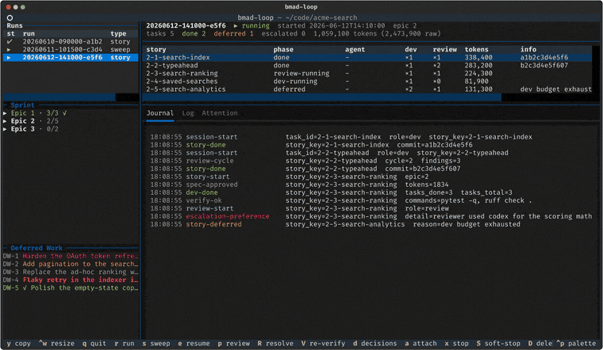
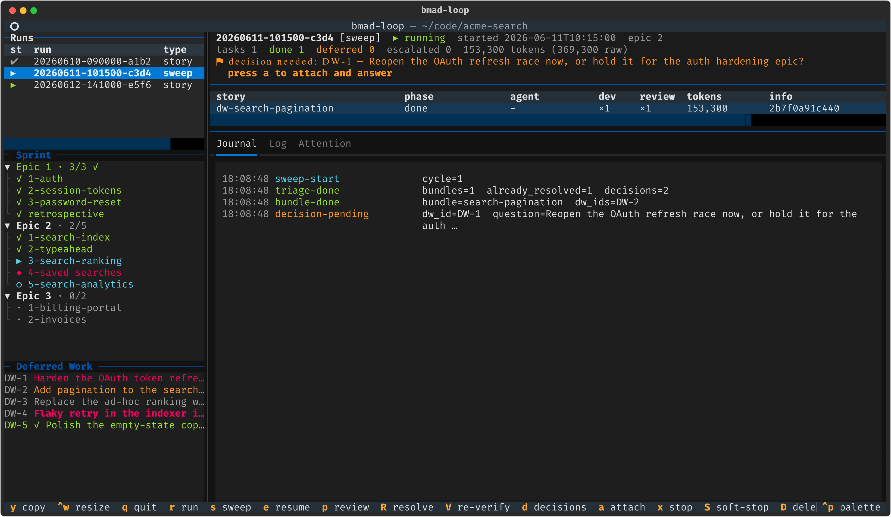
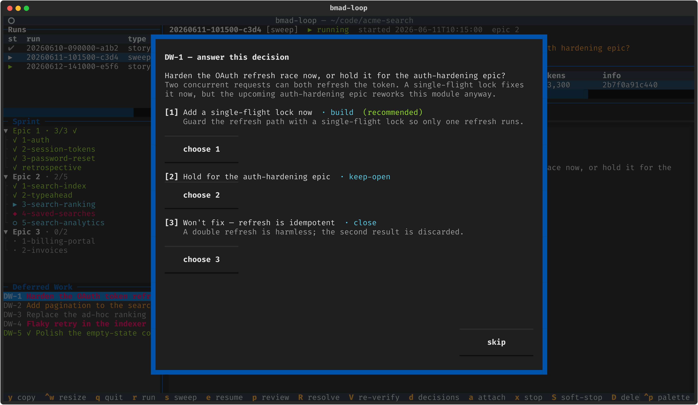
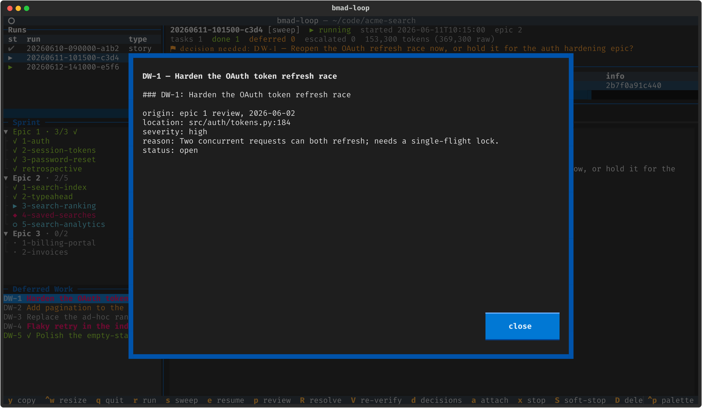
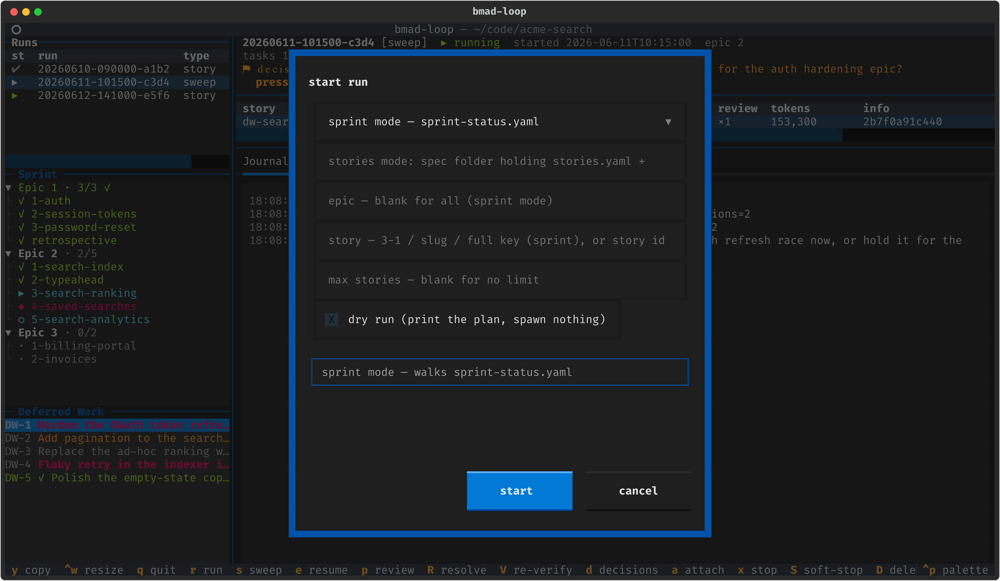
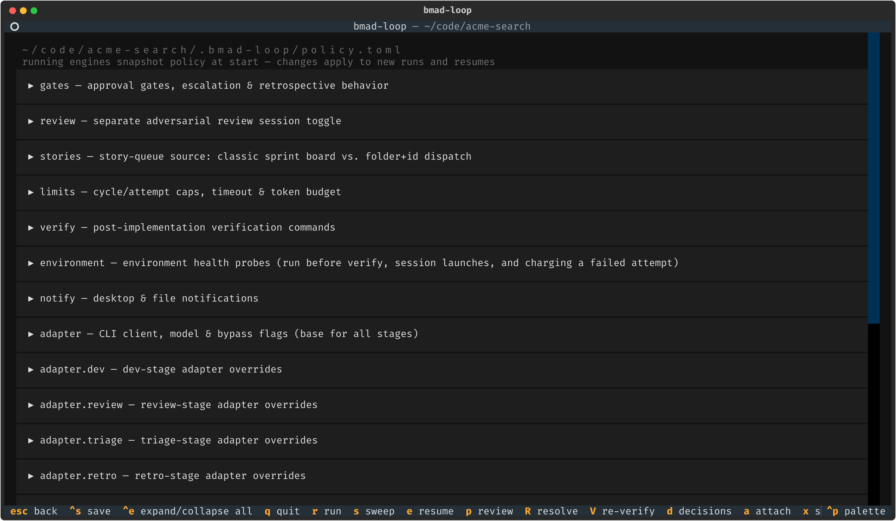
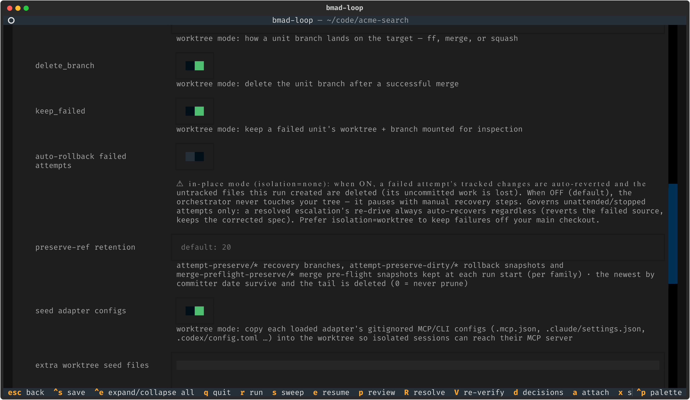

# bmad-loop

<div align="center">

**A deterministic ralph-loop orchestrator for the [BMAD-METHOD](https://github.com/bmad-code-org/BMAD-METHOD) implementation phase**

Plain Python drives the loop — **pick story → implement → adversarially review → verify → commit** — while LLMs do only the creative work, inside disposable, fresh-context coding-agent sessions you can attach to and watch.


[](https://github.com/bmad-code-org/bmad-loop/actions/workflows/ci.yml)


<sub>The live TUI dashboard. <a href="#the-tui">Jump to the TUI tour ↓</a></sub>



<sub>A tour of the dashboard: runs, the sprint tree, a deferred-work entry, answering a decision, the start-run modal, a sweep blocked on a decision, and the policy editor.</sub>

</div>

---

> ⚠️ **Early open beta — experimental, and moving fast.** Expect rough edges and **breaking changes in any pre-1.0 release** (CLI flags, policy keys, on-disk run state, skill contracts). bmad-loop drives real coding agents that write and commit in your repository, so point it at work you can review and roll back (`[scm] isolation = "worktree"` keeps attempts off your main checkout), pin a release tag for a stable base, and read the [CHANGELOG](CHANGELOG.md) before upgrading.
> Report bugs as an [issue](https://github.com/bmad-code-org/bmad-loop/issues) with `bmad-loop diagnose` output attached, or talk to us on [Discord](https://discord.gg/gk8jAdXWmj).

bmad-loop runs BMAD stories unattended. It reads your sprint board (or a v6 `bmad-spec` story breakdown, or a BMAD v7 initiative ticket tree), launches a fresh coding-agent session for each story inside a terminal multiplexer, checks what the session left on disk, runs your tests, and commits — then moves to the next story. It was inspired by the original [bmad-automator](https://github.com/bmad-code-org/bmad-automator) (a separate, legacy project), but here the orchestrator is ordinary code, not an LLM session.

## Why bmad-loop

- 🧠 **No LLM in the control loop.** Story selection, retry budgets, gates and completion checks are plain Python: deterministic, debuggable, and free. A session counts as complete only on a completion event from the coding agent or the death of its session, never on model prose; timeouts, stalls and budget caps end it as a failure.
- 🔍 **Trust nothing, verify everything.** After each session the orchestrator checks the spec status, the baseline commit, that code actually changed, and that the board matches, then runs _your_ `[verify]` commands before it commits.
- 🪟 **Fresh-context review.** Review runs as a separate session that never inherits the implementer's context, optionally on a different CLI or model. It is bounded, so a story cannot oscillate forever.
- 📒 **One board writer.** During a run bmad-loop is the only writer of `sprint-status.yaml` rows; board writes are serialized and never move a story backward, except that a review can return a `done` story to `awaiting-operator`. In ticket-tree mode bmad-loop writes a plan's status only through the project's `tickets.py mark`, and never while that ticket's session is live.
- ♻️ **Built for unattended runs.** Every run is resumable on-disk state. A story that never converges is deferred and the run continues; a CRITICAL escalation pauses for `bmad-loop resolve`; work only a human can do parks until `bmad-loop confirm`.
- 📋 **Deferred work gets done.** Split-off goals and review findings land in a ledger that `bmad-loop sweep` triages against the code and builds through the same pipeline.
- 🔌 **Any of six coding CLIs.** `claude`, `codex`, `gemini`, `copilot`, `antigravity` and `opencode` are TOML profiles, mixable per stage, with cost-weighted token budgets.
- 🌿 **Optional worktree isolation.** Each story runs on its own branch and merges back locally, so your checkout stays free during a run.

## Requirements

- **Python 3.11+** and **git 2.34+** (enforced: `run`, `sweep` and `resume` refuse to start below it).
- **Linux, macOS, or Windows via WSL**, with a terminal multiplexer: tmux (3.2+) is the default. Native Windows uses the bundled psmux backend, which is experimental — see [Terminal multiplexer backends](docs/multiplexer-backends.md).
- A supported coding CLI — `claude` by default, or another [profile](#other-coding-clis).
- A **BMAD v6 project** on **BMAD-METHOD ≥ 6.10.0**, with the upstream dev skill `bmad-build-auto` installed (`bmad-dev-auto` on pre-rename releases). `bmad-loop validate` checks it and any review skills it invokes. Sprint mode also needs a `sprint-status.yaml` from `bmad-sprint-planning`.
- Or a **BMAD v7 project** (the v7 preview, BMAD-METHOD `6.13.0-next` or newer) with the `bmad` and `bmad-build-auto` skills and `uv` on `PATH`, planned with Sofia (`bmad-agent-po`). Ticket-tree mode is experimental; see the [ticket-tree mode guide](docs/tickets-guide.md).

## Quick start

```bash
uv tool install "bmad-loop[tui] @ git+https://github.com/bmad-code-org/bmad-loop.git"

cd /path/to/your/bmad/project
bmad-loop init                   # bundled skills, hooks, .bmad-loop/policy.toml, gitignore
bmad-loop validate               # preflight: config, board, git, multiplexer, CLI, hooks
bmad-loop run --dry-run          # print the plan without spawning anything
bmad-loop run                    # go
bmad-loop tui                    # …or drive everything from the dashboard
```

> **One-time setup:** start the coding CLI once in the project (`claude`) and accept its workspace-trust and hooks prompts before `bmad-loop run`. Spawned sessions can't answer first-run dialogs; see [First-run notes](docs/setup-guide.md#first-run-notes) for each CLI.

On BMAD v7, add the skills with `npx skills add bmad-code-org/bmad-loop`, run `/bmad setup bmad-loop` and then `/bmad-loop-setup`, and set `[stories] source = "tickets"`; see [Installing on BMAD v7](docs/setup-guide.md#installing-on-bmad-v7-bmad-setup).

Every subcommand, flag, `--json` document and exit code is in the [CLI reference](docs/reference/cli.md).

## How a story flows

```text
sprint-status.yaml: 1-2-account-mgmt: ready-for-dev
  │
  ├─ DEV     fresh session: /bmad-build-auto 1-2-account-mgmt
  │          plans a spec, implements, self-reviews, finalizes the spec → done;
  │          the CLI's Stop hook tells the orchestrator the session ended
  ├─ VERIFY  spec status · baseline · non-empty diff · board in sync
  │          · your [verify] commands — a failure feeds a fix session the output
  ├─ REVIEW  fresh session re-invokes /bmad-build-auto on the done spec, when the
  │ (gated)  dev pass recommends it ([review] trigger); at most
  │          [limits] max_review_cycles rounds (default 3)
  ├─ VERIFY  the same checks again after review's patches
  └─ COMMIT  the orchestrator squashes the work into one story commit
             (worktree isolation then merges the unit branch locally);
             epic boundary → gate / retrospective
```

A failed attempt is retried within `[limits] max_dev_attempts`. A story that exhausts its budget is plateau-deferred and the run moves on. An environment fault (a failing `[environment]` probe, or a verify command exiting 126, 127 or `[verify] env_fault_rc`) pauses the run without charging the attempt.
A CRITICAL escalation pauses the run and notifies you (desktop notification and an `ATTENTION` file); `bmad-loop resolve <run-id>` fixes the spec with an interactive agent and re-drives the story. In place (`[scm] isolation = "none"`), a failed or deferred attempt that left changes pauses for you to roll back by hand unless `[scm] rollback_on_failure` is on.
Every pause and its remedy is in [Recovering paused runs](docs/escalations-guide.md).

## Three planning pipelines, one loop

- **Sprint mode (default).** Stories come from `sprint-status.yaml`; the loop picks `backlog` and `ready-for-dev` stories by key.
- **Stories mode (opt-in, BMAD v6).** Stories come from the typed `stories.yaml` that `bmad-spec`'s Story Breakdown (BMAD-METHOD 6.12) writes beside `SPEC.md`, dispatched by spec folder and story id in list order. Each entry can set `spec_checkpoint` (pause after planning, before code) and `done_checkpoint` (pause after the commit).

- **Ticket-tree mode (opt-in, BMAD v7, experimental).** Tickets come from the active initiative's ticket tree, which Sofia (`bmad-agent-po`) plans: she creates the initiative, slices it into epics and stories, and refines and readies the tickets. The loop dispatches each startable ticket in build order and marks it done through the project's `tickets.py`.

Turn stories mode on with `[stories] source = "stories"` and `spec_folder`, or per run with `bmad-loop run --spec <folder>`; turn ticket-tree mode on with `[stories] source = "tickets"`. Everything downstream is the same loop. See [Stories mode](docs/FEATURES.md#stories-mode) and the [ticket-tree mode guide](docs/tickets-guide.md).

## Deferred-work sweeps

Dev and review sessions append split-off goals, pre-existing findings and open questions to a ledger (`deferred-work.md`, `DW-<n>` entries). `bmad-loop sweep` starts a triage session that checks each open entry against the code and sorts it: already resolved (closed with evidence), buildable bundles, blocked, skipped, or a decision for you.
An attended sweep asks each decision on the terminal; bundles then run through the normal dev → verify → review → commit pipeline. Unanswered decisions can be answered later with `bmad-loop decisions` or `d` in the TUI. A story can also close entries itself (`closes_deferred`), and a `gate:` line in an entry blocks the stories it names until it is done.
See the [sweep guide](docs/sweep-guide.md).

## The TUI

```bash
bmad-loop tui        # needs the [tui] extra
```

A live dashboard over every run, and a launcher for new ones. It observes runs only through the files the engine writes, so runs started from a shell show up identically, and the runs it launches are detached processes that survive a TUI exit. Full guide, every key and modal: [docs/tui-guide.md](docs/tui-guide.md).

<div align="center">

</div>

**Dashboard.** Runs, the sprint tree (a stories board in stories mode, a tickets board in ticket-tree mode) and the deferred-work ledger on the left; the run header, per-story task table, and journal, pane-log and `ATTENTION` tabs on the right. Panes are [resizable](docs/tui-guide.md#resizing-panes).

<div align="center">

</div>

**A sweep blocked on a decision.** The dashboard raises a banner; press `a` to attach to the sweep's window and answer.

<div align="center">

</div>

**Answering decisions later.** `d` walks the decisions past sweeps left open; a `close` applies at once, and `build` / `keep-open` are saved for the next sweep.

<div align="center">


</div>

**Ledger entries and launching.** `enter` on a ledger row opens the full entry; `r` opens the start-run modal (sprint, stories or tickets source, epic, story, max stories, dry run) and `s` the sweep modal.

<div align="center">

</div>

**Policy editor.** `g` edits `.bmad-loop/policy.toml` by section, preserving comments and validating with the engine's own parser before saving.

## Installing and upgrading

`bmad-loop init` installs the three bundled skills — `bmad-loop-resolve`, `bmad-loop-sweep` and `bmad-loop-setup` — into each CLI's skills directory, plus the hook relay and the policy file. Your BMAD install is never modified. If the BMAD-method installer already placed the skills, run `claude "/bmad-loop-setup accept all defaults"`: it installs the tool, wires the hooks, and runs the preflight. On BMAD v7, `npx skills add bmad-code-org/bmad-loop` and `/bmad setup bmad-loop` place the skills and the `bmod-bmad-loop` module record, and `/bmad-loop-setup` then does the rest.

To upgrade, run `claude "/bmad-loop-setup upgrade"`, or by hand `uv tool upgrade bmad-loop --reinstall` followed by `bmad-loop init --force-skills` in each project. Pinned-tag installs, other CLIs, upgrading and uninstalling are in the [setup guide](docs/setup-guide.md).

## Configuration

`.bmad-loop/policy.toml` is per-machine (gitignored by `init`), and every key is optional. A minimal example:

```toml
[gates]
mode = "per-epic"            # none | per-epic | per-story-spec-approval
[adapter]
name = "claude"              # claude | codex | gemini | copilot | antigravity | opencode-http
[adapter.review]
name = "codex"               # optional: review on a different CLI
[verify]
commands = ["pytest -q", "ruff check ."]
[scm]
isolation = "worktree"       # none (default, in place) | worktree
merge_strategy = "squash"    # ff | merge | squash
[limits]
session_budget_mode = "warn" # off | warn | enforce
```

Every key, default, allowed value and environment variable is in the [configuration reference](docs/reference/configuration.md).

### Worktree isolation

With `[scm] isolation = "worktree"`, each story and sweep bundle runs in its own git worktree on a `bmad-loop/<run-id>/<story>` branch and merges back into the target branch locally (`ff`, `merge` or `squash`). Run state stays in the main repo, failed units keep their worktree and branch for inspection, and no PRs are opened. For a monorepo, set `repo_root` in `_bmad/bmm/config.yaml`; worktree isolation then needs the project inside `repo_root`. See [Worktree isolation](docs/FEATURES.md#worktree-isolation).

<p align="center">

</p>

### Plugins

A plugin is a folder with a `plugin.toml` manifest: hooks on run and sweep stages, settings, workflows, and an optional in-process Python module. Bundled plugins are trusted by origin, and their Python loads only when listed in `[plugins] enabled`. A project plugin under `.bmad-loop/plugins/<name>/` runs nothing until `bmad-loop plugins enable <name>` records a content hash of it outside the repo. See [Writing a bmad-loop plugin](docs/plugin-authoring-guide.md) and the worked example in [`examples/plugins/guardrails/`](examples/plugins/guardrails/).

### Game-engine projects (Unity)

The bundled `unity` plugin (`[plugins] enabled = ["unity"]`) lets sessions drive a live Unity Editor through an Editor MCP (IvanMurzak or CoplayDev). `editor_mode = "shared"` works in place on your open Editor; `per_worktree` runs one managed Editor per worktree. A readiness gate defers a unit when the Editor never comes up. See the [game-engine plugin guide](docs/game-engine-plugin-guide.md) and the [Editor MCP guide](docs/game-engine-mcp-guide.md).

## Other coding CLIs

Each coding CLI is a declarative TOML profile; built-ins ship in `bmad_loop/data/profiles/`. Per-CLI setup is in the [setup guide](docs/setup-guide.md#first-run-notes).

| Profile       | Status                  | Notes                                                                                                                                                                                |
| ------------- | ----------------------- | ------------------------------------------------------------------------------------------------------------------------------------------------------------------------------------ |
| `claude`      | supported               | Reference implementation.                                                                                                                                                            |
| `codex`       | supported, E2E-verified | Codex ≥ 0.139. The prompt uses `$skill` mentions instead of slash commands. No SessionEnd hook; window death covers crashes.                                                         |
| `gemini`      | supported, E2E-verified | Gemini CLI ≥ 0.46. Launched with `-i`; `AfterAgent` maps to Stop.                                                                                                                    |
| `copilot`     | supported, E2E-verified | Copilot CLI (GA ≥ 2026-02), not the VS Code extension. Pin a capable model; the free default skips workflow steps.                                                                   |
| `antigravity` | experimental            | `agy` ≥ 1.1.3. Folder trust is exact-path, so worktree isolation needs the project root trusted. Reports no token usage.                                                             |
| `opencode`    | supported, E2E-verified | OpenCode 1.x ≥ 1.18 or 2.x ≥ 2.0.21, detected from `--version` (profile `opencode-http`), over HTTP/SSE, no tmux window. Needs the `[opencode]` extra. Unverified on native Windows. |

To add a CLI without Python, drop a profile in `.bmad-loop/profiles/<name>.toml` and finalize it with `bmad-loop probe-adapter <cli>`; see the [adapter authoring guide](docs/adapter-authoring-guide.md).

## Documentation

[docs/README.md](docs/README.md) indexes every guide. The most used:

- [Feature catalog](docs/FEATURES.md) — what bmad-loop does, feature by feature.
- [Setup guide](docs/setup-guide.md) — installing, initializing each CLI, upgrading, uninstalling.
- Reference: [configuration](docs/reference/configuration.md), [CLI](docs/reference/cli.md), [run state](docs/reference/run-state.md).
- [Recovering paused runs](docs/escalations-guide.md) and the [sweep guide](docs/sweep-guide.md).
- [Ticket-tree mode guide](docs/tickets-guide.md) — driving a BMAD v7 initiative ticket tree.
- [TUI guide](docs/tui-guide.md) and [Terminal multiplexer backends](docs/multiplexer-backends.md).

## Development

```bash
uv sync --all-extras             # dev tools plus every extra
uv run pytest -q                 # test suite
uv run pyright                   # typecheck
trunk check                      # lint, as CI runs it
```

The screenshots and demo GIF are rendered headlessly from a mock project: `uv run python scripts/gen_screenshots.py` and `uv run python scripts/gen_demo.py` (they need `resvg`, and the GIF also needs `ffmpeg`). See [CONTRIBUTING.md](CONTRIBUTING.md) and [docs/testing.md](docs/testing.md).

## Contributing

Contributions are welcome. Start with **[CONTRIBUTING.md](CONTRIBUTING.md)** — for anything bigger than a typo or small bug fix, talk to a maintainer on [Discord](https://discord.gg/gk8jAdXWmj) first. By participating you agree to our [Code of Conduct](.github/CODE_OF_CONDUCT.md). To report a vulnerability, see [SECURITY.md](SECURITY.md).

When reporting a bug, attach the output of `bmad-loop diagnose` — a sanitized dump (no code, specs, prompts, paths, or PII) that gives maintainers the run's shape to debug from.

## License

bmad-loop is released under the [MIT License](LICENSE), © BMad Code, LLC. The BMad name and brand are trademarks of BMad Code, LLC and are **not** covered by the MIT License — see [TRADEMARK.md](TRADEMARK.md).
