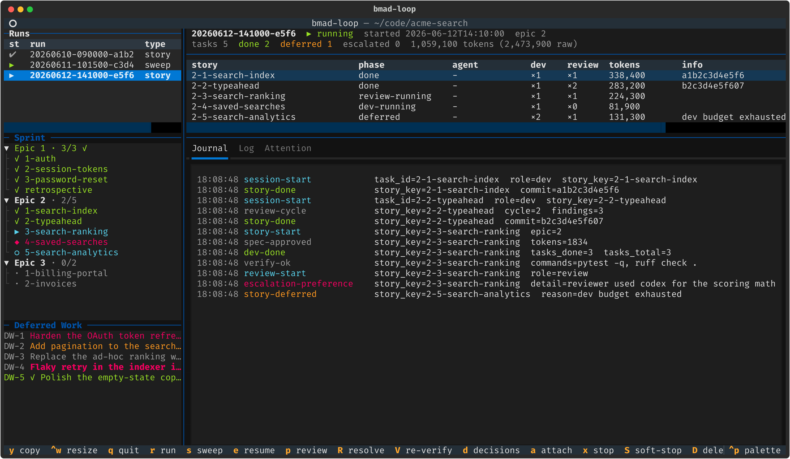

# TUI guide

`bmad-loop tui` is a live terminal dashboard for everything the orchestrator
does: watching runs, launching new ones, resuming paused ones, answering sweep
decisions, and editing policy. This guide covers every screen, key, and
message. For the one-page summary, see the [TUI section of the
README](../README.md#the-tui).

## Installation and launch

```bash
uv tool install "bmad-loop[tui] @ git+https://github.com/bmad-code-org/bmad-loop.git"
cd /path/to/your/bmad/project
bmad-loop tui              # or: bmad-loop tui --project /path/to/project
```

The `[tui]` extra adds `textual`, `tomlkit`, `pyte` and `rich`; from a source
checkout, `uv sync --extra tui` does the same. `--project` defaults to the
current directory.

The selected terminal-multiplexer backend (tmux by default; see
[Terminal multiplexer backends](multiplexer-backends.md)) must be available for
the launch and attach keys. Observation works without it. `bmad-loop mux` shows
which backend is selected and why; the settings editor's `mux.backend` or the
`BMAD_LOOP_MUX_BACKEND` environment variable forces the choice per machine.

Over a slow or high-latency link (SSH, Tailscale), launch with
`bmad-loop tui --low-frame-rate` to cap Textual to 15fps and disable animations,
or set `[tui] low_frame_rate = true` in `policy.toml`. An explicit `TEXTUAL_FPS`
in the environment still wins.

### Terminal sizes

The dashboard shows fewer rows as the window shrinks. The modal dialogs
(confirmations, the start forms, and the escalation, checkpoint, spec and
validate viewers) are the tightest thing the TUI draws:

- **39 columns × 9 rows** is the measured size at which every dialog shows its
  title, one row of body, and all of its docked buttons and warnings.
- Titles, headers, subtitles and file paths are held to one row each and end in
  `…` when too long, so long caller text never changes a dialog's height. The
  spec path is cut from the front so it keeps its file name, and `copy path`
  copies the whole path. At narrow widths a long story title or validate header
  can be cut with no other copy on screen; widen the terminal to read it.
- Below **80 columns** the spec viewer's action row wraps into two columns and
  the viewer takes the terminal's full height.
- Dialogs always clamp to the screen width. Below **60 columns** buttons shrink
  to fit their labels. Below **20 rows** padding and margins collapse and
  buttons render one row tall, without borders.

## Architecture: observer/launcher, never the engine

The TUI never runs an engine in-process.

- **Launcher.** `r`, `s`, `e`, `R` and `V` spawn detached `bmad-loop` processes
  as windows of a dedicated control session, `bmad-loop-ctl`.
  Windows are named `run-<run-id>`, `sweep-<run-id>`, `resume-<run-id>` and so
  on, and run the same Python interpreter as the TUI. A window stays open after
  its command exits, showing `[bmad-loop exited <code> — press enter]`, so you
  can read failures. Quitting or crashing the TUI does not touch them. The
  engine drives its agents in a separate `bmad-loop-<run-id>` session, torn down
  when the run finishes unless `[adapter] cleanup_session_on_finish = false`.
  Attach and stop only reach control windows tagged with this project.
- **Observer.** The dashboard reads only the files in
  `.bmad-loop/runs/<run-id>/`: `state.json`, `journal.jsonl`,
  `logs/<task-id>.log`, `ATTENTION`, `engine.pid`, and `stop-request.json`
  while a stop is pending. It polls the selected run
  every second, and the run list, sprint status and deferred-work ledger every 3
  seconds, re-parsing only files that changed. Runs started from a plain shell
  show up identically; the TUI has no privileged channel. See the
  [run-state reference](reference/run-state.md) for the layout.

Fast read-only commands (`validate`, dry runs) are captured and shown in a
scrollable modal instead of spawned in a control window.

## Dashboard layout

```text
┌─ bmad-loop — /path/to/project ─────────────────────────────────────────┐
│ st run              type │ 20260611-091500-3f2a  ▶ running             │
│ ✔  20260610-…       story│ started 2026-06-11T09:15:00  epic 2         │
│ ▶  20260611-…       story│ tasks 8  done 5  deferred 1  escalated 0    │
├──────────────────────────┤─────────────────────────────────────────────┤
│ ▼ Epic 1 · 4/4 ✓         │ story         phase           dev review …  │
│ ▼ Epic 2 · 1/3           │ 2-3-billing   review-running  ×1  ×2     …  │
│   ✓ 1-auth               ├─────────────────────────────────────────────┤
│   ▶ 2-search             │ Journal │ Log │ Attention                   │
├──────────────────────────┤ 09:15:02 session-start   task_id=…          │
│ DW-1 Fix flaky retry     │                                             │
│ DW-2 ✓ Polish help text  │                                             │
├──────────────────────────┴─────────────────────────────────────────────┤
│ q quit  r run  s sweep  e resume  a attach  v validate  g settings  …  │
└─────────────────────────────────────────────────────────────────────────┘
```

…and the same layout, live:

<div align="center">

</div>

### Left column

Three stacked panes. `tab` / `shift+tab` move focus between them, and their
heights and the sidebar width are adjustable (see [Resizing panes](#resizing-panes)).
The sprint and deferred panes read project files that are also edited outside
the TUI, so a missing or malformed file shows a dim placeholder instead of an
error, and the pane recovers on the next poll.

#### Run list (top)

One row per run under `.bmad-loop/runs/`, oldest first. Columns: `st` (status
glyph, see [Status reference](#status-reference)), `run` (the id), `type`
(`story` or `sweep`), and `note`: a colored pause badge on a paused run (`plan`,
`story`, `spec`, `epic`, `gate`, `esc`, `env`), or `⏹ stop` when a stop request
is pending. When any run is paused waiting for a human, the pane title shows
**`⚑ N need attention`**. The newest run is selected on first load, and a run
you launch is selected immediately, before its directory exists.

#### Sprint tree (middle)

`sprint-status.yaml` as one expandable node per epic, `Epic N · done/total`,
green with a `✓` once every story is done. `enter` (or a click) expands an epic
to its stories and retrospective:

| Glyph | Status                     | Color   |
| ----- | -------------------------- | ------- |
| `✓`   | done                       | green   |
| `▶`   | in-progress                | cyan    |
| `◆`   | review                     | magenta |
| `○`   | ready-for-dev              | cyan    |
| `⏸`   | awaiting-operator          | yellow  |
| `·`   | backlog / optional (retro) | dim     |
| `?`   | anything unrecognized      | dim     |

Expansion state and the cursor survive the refresh.

#### Stories board (middle, stories mode)

When the selected run is in stories mode (`source = "stories"`), the sprint
tree is replaced by a flat board read from that run's `stories.yaml` and the
story specs on disk. One row per story: state glyph and label, the story `id`,
a two-slot checkpoint cell (`S` = `spec_checkpoint`, `D` = `done_checkpoint`,
dim `·` when unset), and the title. The board re-derives on each poll.

| Glyph | State                                    | Color    |
| ----- | ---------------------------------------- | -------- |
| `✓`   | done                                     | green    |
| `▶`   | in-progress                              | cyan     |
| `◆`   | in-review                                | magenta  |
| `○`   | ready-for-dev                            | cyan     |
| `⏸`   | awaiting-operator                        | yellow   |
| `◦`   | draft                                    | dim      |
| `·`   | pending (no spec on disk yet)            | dim      |
| `✖`   | blocked                                  | bold red |
| `⚠`   | ambiguous / sentinel (`sentinel:<kind>`) | bold red |

#### Tickets board (middle, tickets mode)

When the selected run is in tickets mode, the slot shows the run's pinned
initiative as `tickets.py status` prints it, titled `Tickets`. One row per
ticket: state glyph and label, the ref, the epic folder, a three-slot flags cell
(`H` = hitl, `P` = plan checkpoint, `D` = done checkpoint, dim `·` when unset),
and the title. The state is the plan's status when the ticket has a plan, else
`planned` (or `refine` when it must be refined first).

A run that builds one child of a parent initiative shows that child's tickets,
read as `bmad-loop status` reads them: through the child's folder, with the tree
pinned to the parent that `[core] active_initiative` names. A config that no
longer names the parent shows as the board's fault.

`tickets.py` is the project's own code, so the board reads it on the poll worker,
never the UI thread. It runs again only when a `tickets.toml` or `.md` file in the
initiative tree (its `tickets/` folders and epic folders, in either layout), the
config, the script, or the `config_utils.py` it loads changes. A tree that cannot be read shows
`tickets board unavailable:` and the reason, and is retried after 30 seconds.

| Glyph | State                       | Color    |
| ----- | --------------------------- | -------- |
| `✓`   | done                        | green    |
| `●`   | built                       | green    |
| `▶`   | in-progress                 | cyan     |
| `◆`   | in-review / review          | magenta  |
| `○`   | ready-for-dev               | cyan     |
| `◦`   | draft                       | dim      |
| `✎`   | refine (no plan yet)        | yellow   |
| `·`   | planned / backlog (no plan) | dim      |
| `✖`   | blocked                     | bold red |
| `–`   | dropped                     | dim      |

#### Deferred work (bottom)

Every entry in the `deferred-work.md` ledger, in file order: its id and title.
Done entries are green with a `✓`; open entries are colored by their optional
`severity:` field: critical (bold red), high (red), medium (yellow), low (dim),
unspecified (plain). `enter` opens the full entry in a scrollable modal. The
pane title also counts decisions waiting to be answered (see
[Answering missed decisions](#answering-missed-decisions-d)).

### Run header (top right)

A summary of the selected run: id, a `[sweep]` tag for sweep runs, status,
start time, current epic, and a counts line: tasks, done, deferred, escalated,
`awaiting N` (only when non-zero), and tokens as `<weighted> tokens (<raw> raw)`. Weighted totals count cache reads
at `limits.cache_read_weight`.

The **agent line** names who is driving. While a session is open it reads
`agent <name> · <model> · <role>` (`model` omitted when the CLI profile's
default is used; `role` is the session's stage, such as `dev`, `review`,
`triage` or `retro`), with a yellow
`· idle <age>` once the session's transcript (and any subagent transcripts its
profile declares) has been quiet past
`limits.dev_stall_grace_s`, followed by `· in <tool>` when the session is
waiting on a tool call (`unknown` if the transcript could not be read). A session
waiting out a usage-limit reset shows `· quota wait <age>` in place of `· idle <age>`,
followed by `· resets <Ddd HH:MM>` (local time) when the limit line named a reset that
resolved, or the reset text as printed when it did not.

A session parked on a permission prompt shows a yellow
`· parked on permission prompt <age>` in place of the idle and quota-wait arms, followed by
`· auto-denies in M:SS` while the CLI's countdown runs, `· auto-deny due` once it has
passed, or `· auto-deny time unknown` when no countdown was read. Between sessions the
agent line shows the run's configured adapters from its policy snapshot. A run with no snapshot shows no agent line;
an unreadable session identity shows `agent unreadable — <fault>`.

Situational banners below that:

- `⏸ paused [<stage>] — <reason>`, then `press p to review · e to resume`: the
  run stopped at a checkpoint, gate or escalation. Stage labels are
  `plan checkpoint`, `story checkpoint`, `spec-approval gate`, `epic gate`,
  `story gate`, `escalation` and `environment fault`, plus the tickets-mode
  `hitl ticket`, `ticket needs refining`, `ticket tree` and `epic closure`
  (see [Tickets mode](#tickets-mode)). At an escalation, `e`
  skips the escalated story; press `R` to resolve it instead. At an environment
  fault an `[environment]` probe failed; fix the environment and press `e` to
  re-probe and continue.
- `⏹ graceful stop pending — will stop after the current item`: a stop request
  is on disk. A graceful stop finishes the in-flight item through commit, then
  stops (resumable). A hard stop's request shows the same line until the engine
  honors it, usually within seconds.
- `✖ engine crashed — see crash.txt · press e to resume`: the engine recorded
  a crash; the error follows on the next line.
- `✖ engine gone — run was interrupted · press e to resume`: the recorded
  engine pid is dead.
- `escalated: story '<key>' awaiting resolve — press R (bmad-loop resolve <id>)`:
  an unfinished run with no pause stage still has an escalated story, as a
  resume whose engine exited before run end leaves it.
- `⚠ auto-sweep not run: <trigger> (<why>) — deferred work is untouched`: an
  auto-sweep was refused; run `bmad-loop sweep` with a clean worktree. A sweep
  that ran shows a dim `auto-sweep ran: <triggers>` line.
- `⚑ decision needed: <id> — <question> / press a to attach and answer`: an
  attended sweep is waiting on you (see
  [Answering a sweep decision](#answering-a-sweep-decision)).
- `⧗ starting… waiting for the engine to write state.json`: just launched. If
  nothing appears within 10 seconds, an error toast says the launch may have
  failed.
- `⚠ state stale — state.json unreadable (<fault>); showing the last good read`:
  the file failed to parse on two consecutive polls; the header keeps the last
  good read until the file parses again. A run whose `state.json` never parsed
  shows `state unavailable — <fault>`.
- `⚠ journal.jsonl …` / `⚠ ATTENTION …` (dim): that file could not be read this
  poll; its tab keeps what it already showed.

### Task table (middle right)

One row per story (or sweep bundle and triage task) in the selected run:

| Column   | Meaning                                                                                                                                                                                                                                        |
| -------- | ---------------------------------------------------------------------------------------------------------------------------------------------------------------------------------------------------------------------------------------------- |
| `story`  | story key, or the sweep task id                                                                                                                                                                                                                |
| `phase`  | `pending` → `dev-running` → `dev-verify` → `review-running` → `review-verify` → `committing` → `done`, or `deferred` / `escalated` / `awaiting-operator` (committed, human action owed); sweep triage shows `triage-running` / `triage-verify` |
| `agent`  | `<name·model>` of the adapter driving or last driving this row (`·model` dropped for the profile default); `-` if none recorded                                                                                                                |
| `dev`    | dev attempt counter, `×N`                                                                                                                                                                                                                      |
| `review` | review cycle counter, `×N`                                                                                                                                                                                                                     |
| `tokens` | cost-weighted token total (cache reads at `limits.cache_read_weight`), the total budgets judge; `-` until known                                                                                                                                |
| `info`   | defer reason, or the first 12 characters of the commit SHA once committed                                                                                                                                                                      |
| `raw`    | unweighted token total, cache reads at full price                                                                                                                                                                                              |

### Tabs (bottom right)

- **Journal**: every engine event, live-tailed from `journal.jsonl` as
  `HH:MM:SS  <kind>  field=value …`, colored by kind (see
  [Status reference](#status-reference)). `enter` on an entry that carries a
  log position jumps the **Log** tab to that point and pins it there; `escape`
  unpins it and resumes following new output.
- **Log**: the active agent session's pane output (`logs/<task-id>.log`) with
  ANSI colors, under a dim `— <task-id>.log —` header (suffixed
  `(pinned — esc to follow)` after a journal jump). The active task is the last
  `session-start` without a matching `session-end` (else the newest log), and
  the tab follows the engine to the next session. Only the last 256 KB of a
  large log is read on first open. A session that ran a fullscreen
  (alt-screen) TUI shows a yellow note that the pane holds only the final
  frame, with the full transcript's path when known. When the log's session is
  parked on a permission prompt, the tab leads with a yellow
  `⚠ parked on a permission prompt — Y approve · N deny · a attach`, or
  `— a attach to answer` when its profile offers no answer keys.
- **Attention**: the run's `ATTENTION` file (escalations, gate notices). New
  lines after the first poll also raise a warning toast.

The per-session files the adapter writes under `tasks/<task-id>/` are listed in
the [run-state reference](reference/run-state.md#task-directory).

### Selecting and copying text

The **Log** and **Attention** panes are click-drag selectable: select with the
mouse and press `ctrl+c`, or press `y` to copy the whole active pane. The other
panes are interactive widgets and are not drag-selectable.

To select text in any pane, or when the in-app copy cannot reach your system
clipboard, hold your terminal's bypass modifier while dragging: **Shift** on
most Linux terminals and Windows Terminal, **Option/Alt** on iTerm2/macOS.

`ctrl+c` and `y` copy via OSC 52. Inside tmux that reaches the system clipboard
only with `set -g set-clipboard on` and an OSC 52-capable outer terminal.

## Status reference

Run status comes from `state.json` plus a liveness check of `engine.pid`:

| Glyph | Status      | Color       | Meaning                                                                                  |
| ----- | ----------- | ----------- | ---------------------------------------------------------------------------------------- |
| `▶`   | running     | green       | not finished, not paused, engine pid alive                                               |
| `⏸`   | paused      | yellow      | stopped at a checkpoint, gate or escalation; the engine exited. `p` reviews, `e` resumes |
| `⏹`   | stopped     | bold yellow | stopped deliberately (`x` / `S`); `e` resumes                                            |
| `✖`   | crashed     | bold red    | the engine recorded a crash (see `crash.txt`); `e` resumes                               |
| `✔`   | finished    | dim         | run completed                                                                            |
| `✖`   | interrupted | bold red    | engine pid is dead but the run never finished; `e` resumes                               |
| `?`   | unknown     | dim         | liveness can't be determined, or `state.json` is unreadable                              |

Liveness is local only. A run driven from another host on a shared checkout
shows `unknown`, never `interrupted`. See
[Derived run status](reference/run-state.md#derived-run-status).

Journal kinds are colored by the first matching substring:

| Match                                           | Color  | Examples                                                        |
| ----------------------------------------------- | ------ | --------------------------------------------------------------- |
| `journal-line-unreadable` (exact kind)          | red    | a journal line that could not be parsed; shows only `bytes=<n>` |
| `escalation-resolved`, `escalation-adopted`     | green  | positive escalation outcomes, matched before `escalat`          |
| `escalat`, `failed`                             | red    | `preference-escalation`, `review-verify-failed`                 |
| `done`, `complete`, `finished`                  | green  | `story-done`, `run-complete`                                    |
| `decision`, `deferred`, `boundary`, `truncated` | yellow | `decision-pending`, `epic-boundary`                             |
| `start`, `resume`                               | cyan   | `session-start`, `run-resume`                                   |
| anything else                                   | dim    |                                                                 |

## Key bindings

| Key       | Action                                                                                        |
| --------- | --------------------------------------------------------------------------------------------- |
| `r`       | start a run (modal)                                                                           |
| `s`       | start a deferred-work sweep (modal)                                                           |
| `e`       | resume the selected paused/interrupted run (confirm modal)                                    |
| `p`       | review the selected paused run in its HITL viewer                                             |
| `R`       | resolve a run paused at an escalation, then re-arm; close a tickets epic                      |
| `V`       | re-verify a story's kept work (pick target)                                                   |
| `d`       | answer deferred-work decisions sweeps left open (modal walk)                                  |
| `a`       | attach to the selected run's live session or window                                           |
| `Y` / `N` | approve / deny a parked permission prompt (only while one is live and answerable)             |
| `x`       | stop the selected live run, abandoning the in-flight item (confirm modal)                     |
| `S`       | graceful stop: finish the in-flight item, then finalize and stop (confirm modal)              |
| `D`       | delete the selected run's directory (confirm modal)                                           |
| `A`       | archive the selected run to `.bmad-loop/archive` (confirm modal)                              |
| `c`       | clean up multiplexer sessions of finished runs (confirm modal)                                |
| `v`       | run `bmad-loop validate`, findings in a modal (`d` toggles detail)                            |
| `g`       | settings editor for `.bmad-loop/policy.toml`                                                  |
| `M`       | toggle light/dark mode                                                                        |
| `y`       | copy the active Log/Attention pane to the clipboard                                           |
| `escape`  | unpin the log view and follow new output                                                      |
| `ctrl+w`  | enter/leave pane resize mode                                                                  |
| `q`       | quit (running engines are unaffected)                                                         |
| `ctrl+p`  | command palette: every command above, filtered to what is live on the current screen or modal |

In the settings editor: `ctrl+s` saves, `ctrl+e` expands or collapses all
sections, `escape` goes back without saving. In any modal, `escape` cancels.
The palette lists these only inside the editor or modal.

### Resizing panes

Every pane boundary is adjustable by mouse or keyboard. Sizes persist per
project under `[tui]` in `policy.toml` and are re-applied on the next launch.

- **Mouse**: drag a divider bar: the split between the sidebar and the detail
  pane, the bars between the stacked left-column panes (they double as the
  Sprint and Deferred Work headings), and the bar between the task table and the
  tabs. Bars highlight on hover.
- **Keyboard**: `ctrl+w` enters resize mode (the header shows a hint). `←`/`→`
  resize the sidebar, `↑`/`↓` move the active horizontal boundary,
  `tab`/`shift+tab` pick which horizontal boundary is active, and `escape` or
  `enter` leaves the mode.

To return to the default proportions, delete the `[tui]` size keys from
`policy.toml` or set them to `0`.

## Starting runs and sweeps (`r` / `s`)

`r` opens the **start run** modal. Every field is optional:

- **source**: `sprint mode` (walks `sprint-status.yaml`), `stories mode`
  (folder-and-id dispatch) or `tickets mode` (the BMAD v7 ticket tree),
  prefilled from `[stories]`. Tickets mode previews the active initiative: its
  ticket counts and the refs that pause on hitl or a checkpoint. On a parent
  initiative it lists the children in build order, each with its status, closed
  and total tickets, what it waits on and a tag (`first ready`, `ready`,
  `waiting`, `no folder`, `closes first`, `done` or `dropped`), then the counts
  and checkpoint refs of the `first ready` child (the first ready child with a
  folder once a run closes the drained ones), or why no child can start. A run
  passes over a ready child with nothing to dispatch and keeps open a drained
  one with an epic to close, so `run --dry-run` names the child it builds first. A
  tickets pick launches only while `[stories] source = "tickets"`. Under that policy a
  stories pick still launches (its `--spec` overrides the policy source); a
  sprint pick does not.
- **spec folder**: stories mode only. The epic spec folder holding
  `stories.yaml` and `SPEC.md`; it drives a live schedule preview that validates
  the manifest and lists the schedule with `[spec/done]` checkpoint markers and
  each story's state. Stories mode with an empty spec folder is refused.
- **epic**: restrict to one epic: a number, or in tickets mode an epic id or
  slug. Any other text outside tickets mode keeps the modal open.
- **story key**: restrict to one story (a story id in stories mode, a ticket ref
  in tickets mode).
- **max stories**: stop after N stories.
- **dry run**: print the plan without spawning anything; output shows in a modal.

`s` opens the **start sweep** modal:

- **unattended (`--no-prompt`)**: skip decision prompts and leave decisions open.
- **decisions only**: triage and answer decisions, run no bundles.
- **max bundles**: override `[sweep] max_bundles`.
- **dry run**: list open ledger entries without spawning anything.

`r` and `s` open only when the multiplexer backend is available. Before a real
launch the TUI applies the same guard as the CLI:

1. git must meet the supported version floor.
2. Worktree isolation must not conflict with the configured `repo_root`.
3. The code root's git worktree must be clean (`.bmad-loop/policy.toml` is
   exempt).
4. If another run on this project may be live, or the run listing could not be
   fully read, a confirmation (`another run may be live`) asks before you
   **launch anyway**.

On success a toast names the run id and the control session, and the dashboard
selects the new run.

## Resuming (`e`)

`e` resumes the selected unfinished run: paused, stopped, crashed or
interrupted. It refuses finished runs and runs whose state is unreadable. The confirmation shows `paused at <stage> — <reason>` for a paused
run, or `run is not paused — it looks interrupted`.
For a story run it adds a yellow
`story '<key>' is still escalated — resume skips it; resolve it with bmad-loop resolve <id>`
line for each escalated story.

If the original engine still appears to be running, the confirmation adds, in
bold red, `engine.pid may still be live — resuming could double-drive this run`.
Confirming checks again, and if the engine still looks live nothing launches.
Two engines driving one run corrupt each other's state; the pid may also have
been recycled by another process. Stop the run, or confirm the pid belongs to
another process, before you resume.

For an unfinished sweep, confirming first checks that the deferred-work ledger
in the main checkout is readable. If it is not, an error toast carries the same
repair guidance as the CLI and nothing launches; repair the ledger, then resume
again. See [When the ledger won't read](sweep-guide.md#when-the-ledger-wont-read).

Confirming spawns `bmad-loop resume <run-id>` in the control session. Resume
replaces any stale `bmad-loop-<run-id>` session with a fresh one.

## Cleaning up sessions (`c`)

`c` closes leftover multiplexer artifacts for this project after a
confirmation: the agent sessions of runs whose engine is no longer alive
(including orphans whose run directory is gone) and the parked
`[bmad-loop exited …]` windows in the control session. Live runs, the window
you pressed `c` from, and other projects' sessions are always spared. A toast
reports how many sessions and windows closed. The shell equivalent is
`bmad-loop cleanup` (`--dry-run` to preview).

`c` does not reclaim disk. Use `bmad-loop clean` for run directories and
orphaned worktrees; it has no TUI key. See
[Reclaiming sessions and disk](reference/run-state.md#reclaiming-sessions-and-disk).

`D` (delete) and `A` (archive) act on one run directory and refuse a live run
with `run <id> is live — stop it first`. Both also refuse a sweep run holding
unlanded ledger closes, with an error toast naming the entries.

## Resolving an escalation (`R`)

`R` works on a run paused at the `escalation` stage, or on an unfinished story
run with no pause stage and a story still escalated (it resolves the first such
story), and refuses a run whose engine may still be live. A CRITICAL escalation parks its story at
`escalated`, which a plain resume skips; `R` is how you un-stick it.

1. Confirming launches `bmad-loop resolve <run-id>` in a control window and
   attaches you to it.
2. Work with the resolve agent, which is seeded with the escalation and the
   frozen spec, to fix the spec.
3. When the agent exits, the window asks
   `re-arm <story> and resume run <id>? [y/N]`, after a
   `no resolution recorded` note if the agent wrote none. Answer `y` to re-arm
   the story and resume the run; any other answer leaves the story escalated
   and the run paused.
4. Detach (`ctrl-b d` on tmux) to return to the dashboard.
   For every resolve mode, see
   [Resolving an escalation](escalations-guide.md#resolving-an-escalation).

At a tickets `epic-boundary` pause, `R` confirms `open bmad-agent-po for epic
<slug>?` and launches the [epic-close resolve](escalations-guide.md#epic-closure-in-tickets-mode)
in a control window: close and commit the epic there, and the run resumes in
that window once bmad-loop has checked the closure. When the epic's
retrospective has not run or is not committed, or the pause names no epic, `R`
shows the step to take instead.

At an `environment` pause, `R` refuses: fix the environment, then resume with
`e`. At a pause whose
story was **deferred** rather than escalated, `R` and `p` open the re-verify
picker (below).

### Re-verifying kept work (`V`)

`V` runs [`bmad-loop resolve <run> --reverify`](escalations-guide.md#resolve-reverify)
on a paused run. It opens a picker listing every target: the paused story
(marked `(paused story)`) when it is deferred, or escalated at an
environment-fault site a replay can clear, then each deferred worktree unit
(marked `(worktree unit)`). Confirming launches the command in a control window
and attaches. The CLI then shows HEAD and the baseline, asks you to confirm, and
resumes, or refuses what it cannot re-verify.

`V` launches nothing on an unpaused run, on a run with nothing to re-verify,
or when the engine may still be live. To move on without re-verifying, resume
with `e`.

## Reviewing a paused run (`p`)

`p` opens the viewer for the selected run's pause stage. Every action calls the
same code path as the CLI, and every viewer reads files the engine already
wrote. The pause badges in the run list and header name the stage, so you know
which viewer `p` opens.

- **Plan checkpoint** (`spec_checkpoint`, stories mode): the planned
  `ready-for-dev` spec, with a copy-path action. Under worktree isolation the
  path is the run's own copy. **Approve & resume** continues to
  implementation; **Request replan** resets the spec to `draft` and resumes so
  the next dispatch re-plans. Edit the spec in your own editor; the TUI never
  edits specs.
- **Story checkpoint** (`done_checkpoint`, stories mode): a summary of the
  just-committed story (title, commit, verification outcome, tokens).
  **Continue run** resumes; **Stop run** marks the run stopped.
- **Escalation**: the story's title and description, the blocking condition from
  the spec's `## Auto Run Result`, and a marker when the spec is a pre-planning
  sentinel. **Resolve** launches the same agent as `R`. **Re-arm & resume** is
  enabled once a resolution is recorded. It re-drives the story from scratch,
  so a recorded restore patch is dropped (the viewer warns); run
  `bmad-loop resolve` to apply one.
- **Spec-approval gate**: the spec viewer; **Approve & resume** continues.
- **Story gate, epic boundary, environment**: a pause-reason viewer that names
  the blocking entries, or the failed probe, and the remedy. **Resume** re-checks
  the condition and re-pauses if it still holds.

A viewer whose spec cannot be read says so and disables the actions that would
act on it. Every action that resumes refuses a still-live engine.

### Tickets mode

A tickets run (the BMAD v7 ticket tree) reuses most viewers. The pause viewers
read `state.json` and plan frontmatter only. The
[tickets board](#tickets-board-middle-tickets-mode) and the start-run preview
run `tickets.py`, always off the UI thread.

| Stage             | Badge    | What `p` shows                                                                                                                                                                                                                                                                                                                                               |
| ----------------- | -------- | ------------------------------------------------------------------------------------------------------------------------------------------------------------------------------------------------------------------------------------------------------------------------------------------------------------------------------------------------------------ |
| `ticket-hitl`     | `hitl`   | The pause reason: the next ticket needs a person in the loop. Build it, then **Resume**.                                                                                                                                                                                                                                                                     |
| `ticket-refine`   | `refine` | The pause reason: the next ticket needs refining with `bmad-agent-po`. Refine it, then **Resume**.                                                                                                                                                                                                                                                           |
| `ticket-tree`     | `tree`   | The pause reason: the pinned initiative changed, `tickets.py` failed, the initiative folder is dirty, or only other tickets block progress.                                                                                                                                                                                                                  |
| `epic-boundary`   | `epic`   | The epic-closure viewer: the retrospective verdict the run recorded, the retrospective's path, and the closure steer. **Close with bmad-agent-po** launches the same epic-close resolve as `R`; it is absent when `R` would show a step instead.                                                                                                             |
| `plan-checkpoint` | `plan`   | The plan viewer. **Request replan** marks the plan `draft` through `tickets.py mark` (reason `replan`), never by editing frontmatter, then resumes. The run stays paused on a refused or no-op mark, a changed ticket store, an isolation layout resume would refuse, a swapped worktree mount, or a run another controller moved to a different checkpoint. |

The run header labels an `epic-boundary` pause `epic closure` in tickets mode.
A ticket's title and description come from the task the run recorded, so a
pick-time pause shows only the ref.

## Attaching (`a`) and the sweep decision flow

`a` picks its target in this order:

1. **A sweep waiting on a decision, or no live agent session**: the run's
   orchestrator window in the control session (only runs launched from the TUI
   have one).
2. **A live agent session**: the run's `bmad-loop-<run-id>` session.
3. **Neither**: a warning that there is nothing to attach to.

Inside tmux, attach switches your client and the TUI keeps running. Outside
tmux, the TUI suspends, attaches, and comes back when you detach (`ctrl-b d`).
Other backends have their own detach chord; see
[Terminal multiplexer backends](multiplexer-backends.md).

### Answering a sweep decision

An attended sweep that reaches an entry needing a human decision waits at its
own terminal prompt. The dashboard shows the `⚑ decision needed` banner and a
one-time warning toast.

1. Press `a`. With a decision pending it always targets the sweep's window.
2. Answer the prompt: build, close, or keep-open, with the triage
   recommendation shown.
3. Once you have answered, the sweep hands your terminal back to the TUI and
   runs unattended for the rest of the run. Later decisions wait for `d`.

The banner clears once the sweep journals its next event. Sweeps launched
**unattended** never prompt. What each answer does is in
[Answering decisions](sweep-guide.md#answering-decisions).

### Answering a parked permission prompt

When a session waits on a permission prompt, the header shows it and the Log tab leads
with the parked note. `Y` approves and `N` denies it, without attaching. They show in the
footer and the palette only while the selected run's log session is parked and its
profile declares `[parked_answers]` (the shipped `claude` profile does).

Before any key goes out, the answer re-checks that:

1. the run's journal still shows the prompt as live;
2. the session's window is still alive;
3. the session's profile declares the answer keys;
4. a fresh capture of the pane matches every guard pattern of the chosen answer.

Any failed check sends nothing and shows a toast with the reason, ending `— attach (a) to
answer`. A sent answer is journaled as `parked-answered` and the parked note clears on the
next poll.

- **Any key cancels Claude Code's auto-deny countdown.** After that the prompt waits for
  an answer indefinitely, which is why the guards must match first.
- **A denial can end the session's turn.** Claude Code stops the turn on a denied prompt,
  so the session may then end parked or with no work, and the run pauses for you.
- **`bmad-loop resolve` sessions keep the bypass flags** whatever
  `adapter.permission_mode` is, since you are attached and can answer prompts yourself.

To answer a prompt the keys cannot (another dialog, or a guard that does not match), press
`a` and answer it in the session's window.

### Answering missed decisions (`d`)

For decisions an unattended sweep skipped, or a prompt you walked away from,
press `d`. The Deferred Work pane title shows the count,
`Deferred Work — N to answer (d)`, or `Deferred Work — decisions unreadable (d)`
when they cannot be read; `d` then shows the fault instead.

1. Press `d`. Each decision opens in its own modal: the question, context, and
   each option with its effect and the triage recommendation.
2. Pick an option. Skip (or `escape`) ends the walk; that decision and any
   after it stay pending for the next `d`.
3. A toast says how many answers were recorded (`recorded N decision(s)`).
   Warnings name any answer that could not be written to the ledger or
   published.

The CLI equivalent is `bmad-loop decisions` (`--list` to view only). Where
answers are stored and how the next sweep uses them:
[Answering decisions](sweep-guide.md#answering-decisions).

## Validate (`v`)

`v` runs `bmad-loop validate --json` in the background and shows the result in a
scrollable modal: a verdict header with per-severity counts and the queue mode,
then one row per check (glyph, check id, message). The check ids are listed in
the [CLI reference](reference/cli.md).

The verdict is the document's own `ok`, not the exit code. A check's `detail`
shows inline for warnings and problems; `d` toggles it on for every row. When
anything failed, a footer notes that the gates are chained: a failed gate stops
the later ones, so a short list after a failure is not the full list of
problems. If the output cannot be rendered as a document, `v` re-runs validate in
text mode and shows its output.

## Settings editor (`g`)

`g` edits `.bmad-loop/policy.toml`.

- **Comment-preserving.** Saving rewrites only the keys you changed; comments,
  order and formatting stay as they were. A missing file starts from the
  commented template `bmad-loop init` writes.
- **Applies to new runs and resumes.** Running engines snapshot policy at start.
  A resume re-stamps the snapshot, so changing `limits.cache_read_weight` and
  resuming re-weights the run's whole token history.
- **Grouped by section.** Every section starts collapsed with a one-line
  description; `ctrl+e` expands or collapses them all. Unset keys show their
  default as a placeholder, and clearing a field deletes the key.
- **Validated on save.** `ctrl+s` parses the whole document with the engine's
  own policy parser; errors appear in a red strip above the buttons and block the
  save. The write is atomic, and is refused if `policy.toml` is read-only.

Every key, its type, default and allowed values are in the
[configuration reference](reference/configuration.md#policy-settings). The form
is built from the same schema, so the two always match.

`extra_args` fields have a switch. Off keeps the profile's default flags (the
key stays absent); on replaces them with exactly the list you type, parsed
shell-style, where an empty list is a valid override. An override replaces the
profile's permission-bypass flags too, so repeat them; `bmad-loop validate`
warns (`policy.bypass-dropped`) when they are missing.

### Plugins

Every enabled plugin's settings appear in a section of their own and save to
`[plugins.<name>]`; the Unity settings, for example, appear only once `unity` is
in `[plugins] enabled`. A plugin's settings are validated on save, so an invalid
combination, such as Unity's `per_worktree` with `scm.isolation = "none"`,
blocks the save.

For a project plugin with an executable surface (hooks, workflows, seeds or
`[python]`), the toggle **is the trust grant**, the same grant
`bmad-loop plugins enable` records:

- **Toggle on** and save to record the grant, after validation passes and
  `policy.toml` is written. A `[python]` plugin's module runs during that save.
- **Toggle off** and save to revoke the grant.
- **An untouched toggle changes nothing.** A plugin that is enabled but not
  granted, or whose grant is changed, stale, missing or unreadable, blocks every
  save with the same message a launch would print. Fix it with the command that
  message names (`bmad-loop plugins enable`, `accept` or `revoke <name>`), or
  toggle the plugin off. Each row shows its grant status; a grant whose plugin
  is gone has no row, only a status line above the roster.

See [Writing a bmad-loop plugin](plugin-authoring-guide.md) for the settings
schema and trust model, and the
[Game Engine plugin](game-engine-plugin-guide.md) and
[Editor MCP plugin](game-engine-mcp-guide.md) guides.

## Troubleshooting

| Message                                                                             | Cause / fix                                                                                                                                |
| ----------------------------------------------------------------------------------- | ------------------------------------------------------------------------------------------------------------------------------------------ |
| `multiplexer backend unavailable — launch/attach disabled`                          | install the selected backend (tmux by default; see `bmad-loop mux`); the dashboard still works read-only                                   |
| `git worktree is not clean — commit or stash first`                                 | the launch guard; commit or stash and retry. `.bmad-loop/policy.toml` is exempt                                                            |
| `another run may be live` (`live or unknown: <ids>`)                                | two engines on one project may conflict, or the run listing could not be read; **launch anyway** only if they won't touch the same stories |
| `launch may have failed — attach to control session <name>`                         | no `state.json` within 10 s of launch; attach to the named session to read the error (the window stays open with the exit code)            |
| `no run selected`                                                                   | the key needs a selected run, and the project has none yet                                                                                 |
| `could not read past sweeps' decisions: <fault>`                                    | `d` could not read the missed decisions; fix the named config or ledger fault (`bmad-loop decisions` reports the same)                     |
| `state for run <id> is unreadable`                                                  | corrupt or missing `state.json`; inspect the run dir                                                                                       |
| `run <id> already finished`                                                         | finished runs can't be resumed                                                                                                             |
| `an environment pause needs no resolve: …`                                          | `R` at an environment pause; fix the environment, then resume with `e`                                                                     |
| `run <id> is live — stop it first`                                                  | `D` and `A` refuse a live run; stop it with `x` or `S` first                                                                               |
| `nothing to attach: no live agent session … runs started outside the TUI have none` | between sessions there is no agent window, and shell-started runs have no control window; wait for the next session                        |
| `cannot suspend here — run manually: tmux attach …`                                 | the terminal can't suspend the TUI; run the printed command in another terminal                                                            |
| `engine.pid may still be live — resuming could double-drive this run`               | the original engine still runs, or its pid was recycled; check before resuming                                                             |
| `policy.toml is not valid TOML: …`                                                  | the file is syntactically broken; fix it in an editor, since the settings screen needs a parseable document                                |
| sprint tree shows `sprint status unavailable`                                       | missing or invalid `_bmad/bmm/config.yaml` or `sprint-status.yaml`; run `bmad-loop init` / `bmad-sprint-planning`                          |
| deferred pane shows `deferred ledger unavailable`                                   | missing or unreadable `deferred-work.md`; normal until the first session defers something                                                  |
| header shows `state unavailable`                                                    | `state.json` is missing or never parsed; usually transient at launch                                                                       |

A file caught mid-write or missing never crashes a poll: the dashboard keeps
the last good state (`?` / `unknown` where it has none) and catches up on the
next tick.
